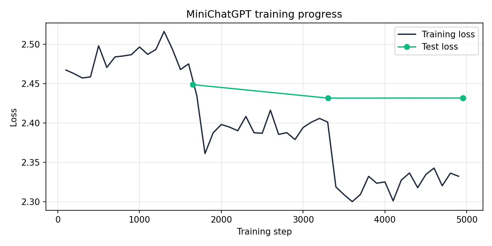

# MiniChatGPT

A ChatGPT-style chatbot built only with **free tools**.

- **Main brain:** Google **Gemini API** (free tier). It answers almost any question and remembers the conversation.
- **Backup brain:** **my own model**, `google/flan-t5-small` fine-tuned on the cleaned **DailyDialog** dataset.
  If Gemini fails (busy, free limit reached, no internet, or too slow), the app switches to my model automatically.

## How it works

```
User message
    │
    ▼
ChatRouter ──► Gemini (main model) ──► answer   🌐
    │   busy / too slow
    ├────────► Gemini (backup model) ──► answer  🌐
    │   still failing
    └────────► My trained model ──► answer       🧠
```

## Features

- Full-screen, ChatGPT-style chat page (Gradio), with 60-30-10 colors
- Answers appear word by word (streaming)
- Chat memory: Gemini remembers the last 20 messages
- Chat history: past chats are saved in the browser and can be reopened
- 3 answer modes: **Auto**, **Gemini only**, **My model only**
- A label under every answer shows who answered (🌐 Gemini / 🧠 my model)
- Automatic fallback: retry, backup Gemini model, then my model, with a 15-second time limit

## Project phases

| Phase | What | Files |
|---|---|---|
| 1. Get the data | Download DailyDialog from Hugging Face and clean it | `src/data/download_dataset.py` |
| 2. Check and split | Validate, then split 90% train / 10% test | `src/data/validate_dataset.py`, `src/data/split_dataset.py` |
| 3. Train | Fine-tune flan-t5-small on Google Colab (free T4 GPU) | `notebooks/MiniChatGPT_Training.ipynb` |
| 4. Chatbot brain | Gemini + my model + automatic fallback | `src/chatbot/` |
| 5. Chat screen | Gradio web app | `app.py` |
| 6. Finish | README, reports, testing | `README.md`, `reports/` |

## Dataset (DailyDialog)

| Step | Pairs |
|---|---|
| Raw question-answer pairs | 76,052 |
| Removed: too long (over 25 words) | 9,680 |
| Removed: duplicates | 7,700 |
| **Clean pairs** | **58,672** |
| Train / test split | 52,804 / 5,868 |

Cleaning: lowercase, fixed spacing (`it ' s` → `it's`), fixed missing spaces (`right.but` → `right. but`), removed strange characters, long sentences, and duplicates.

## Training (Google Colab, T4 GPU)

| Setting | Value |
|---|---|
| Base model | google/flan-t5-small (77M parameters) |
| Epochs / batch size / learning rate | 3 / 32 / 3e-4 |
| Precision | fp32 (fp16 caused `nan` loss with T5) |
| Loss before training | 2.968 |
| Test loss per epoch | 2.449 → **2.432** → 2.432 (best epoch kept) |
| Training time | 17.9 minutes |



**Before vs after training:**

| Message | Before | After |
|---|---|---|
| hi, how are you? | Hi, what are you doing? | I'm fine, thanks. |
| where do you work? | — | I work at a telecommunications company. |
| i want to buy a new phone. | — | Where are you going to get it? |

## Folder structure

```
Minichatgpt/
├── app.py                  # chat screen (run this)
├── test_chatbot.py         # tests the brain without the screen
├── requirements.txt
├── .env.example            # copy to .env and add your Gemini key
├── data/processed/         # cleaned data, train.jsonl, test.jsonl
├── models/minichatgpt-model/   # my trained model (from Colab)
├── notebooks/MiniChatGPT_Training.ipynb
├── reports/                # cleaning + training reports, loss chart
└── src/
    ├── data/               # phase 1-2 scripts
    └── chatbot/
        ├── config.py       # settings
        ├── api_bot.py      # Gemini API
        ├── local_bot.py    # my trained model
        └── router.py       # chooses who answers (fallback)
```

## How to run

```powershell
# 1. Create and activate a virtual environment
python -m venv .venv
.venv\Scripts\Activate.ps1

# 2. Install the libraries
pip install -r requirements.txt

# 3. Add your free Gemini key (https://aistudio.google.com/apikey)
copy .env.example .env      # then open .env and paste your key

# 4. Put the trained model in models/minichatgpt-model/

# 5. Test the brain, then start the app
python test_chatbot.py
python app.py
```

Open **http://127.0.0.1:7860**. Use `python app.py --share` for a public link.

## Tools used (all free)

Hugging Face Datasets · Google Colab (T4 GPU) · Transformers · PyTorch · Google Gemini API · Gradio

## Limitations

- My trained model is small and only sees the latest message, so its answers are short and simple. It's good at small talk, not facts.
- The Gemini free tier has daily limits and can be busy. That's why the fallback exists.
- Chat history is saved per browser.